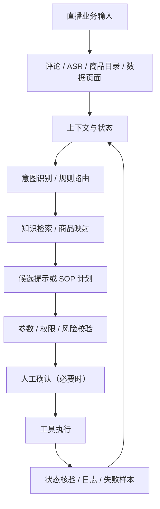

# 小满｜直播电商业务 AI 自动化与 Agent 项目

> 面向 FDE（Forward Deployed Engineer）/ AI 数字化落地岗位的项目作品集。项目来自直播电商一线业务，重点展示业务问题拆解、AI 副驾设计、自动化工作流、工具集成和验收闭环。

## 项目概览

小满从直播中控的真实工作流程出发，围绕评论理解、商品上下文、数据采集、后台 SOP 和语音触发讲解逐步搭建。我的主要工作是识别业务问题、拆解需求、设计模块与工作流、定义指标口径和验收标准，并通过 AI Coding 协作推进实现、联调、测试和迭代。

项目原则：模型负责适合它的理解与辅助决策；确定性操作交给规则和工具；涉及业务状态变化时核验执行结果；不让模型编造价格、库存或活动事实。

## 关键成果（按验证层级标注）

| 方向 | 已有结果 | 验证状态 |
|---|---|---|
| AI 评论意图识别 | 32 条离线样本，30 条有效返回，26 条分类匹配（26/32 = 81.25%） | 离线评测，不是线上准确率 |
| 商品知识模块 | 10 款商品、30 个 SKU 草稿、107 条 FAQ（106 条有答案） | 离线基础模块，不含实时库存/价格 |
| 数据自动化 | 半点 8 项 / 30 分钟；整点 6 项 / 60 分钟；Phase 6 两条链路各 4/4 成功、21 项测试通过 | 阶段性真实工作流验收 |
| 混合来源工作流 | Phase 10 一次真实定时运行：千川 + 罗盘、6 项冻结指标、2 个 Snapshot、1 条 History、cleanup complete | 有验收摘要；原始业务导出未公开 |
| DOM / SOP | 本地页面孪生 + SOP 引擎；跑通商品 ID 检索到库存抽屉查看 | 本地模拟页面验证 |
| 语音触发讲解 | 轻量 ASR、商品索引、误触拦截 / Dry Run / 授权 / 日志；单次真实点击验证 | 部分真实验证，不代表全场景稳定 |

## 作品集导航

- [项目案例与个人贡献](docs/project-case-study.md)
- [可核验成果与验证边界](docs/evidence-and-validation.md)
- [系统架构与关键流程](docs/architecture.md)
- [3–5 分钟演示脚本](docs/demo-script.md)

## 项目架构

该图描述设计分层，不代表所有模块已完成同一生产环境的端到端联调。

## 个人贡献与技术边界

我主要负责业务需求、流程设计、模块边界、数据口径、测试用例、联调和业务验收。代码实现通过 Codex 等 AI Coding 工具协作推进；我能阅读和修改基础代码，完成 API / JSON 对接与排错。不将 AI 生成代码包装成独立手写完整后端。

## 代码与证据访问

- 本仓库为公开作品集说明仓库，不包含完整源代码或公司业务数据。
- 小满数据自动化 POC 源码仓库目前为私有仓库：[xiaoman-data-automation-poc](https://github.com/hjs980824/xiaoman-data-automation-poc)。
- 私有仓库包含 V2 模型、数据归一化、Store、Scheduler、测试脚本及 Phase 10 验收摘要；如需技术核验，可在授权后查看。
- Phase 10 原始导出和独立核验文件保留本地，仓库仅保留文件哈希与验收摘要；公开材料不声称可以单凭公开仓库复现真实业务运行。

## 推荐阅读顺序

1. [项目案例](docs/project-case-study.md)：业务问题、个人负责内容与方案取舍。
2. [证据与验收边界](docs/evidence-and-validation.md)：量化结果、验证层级和代码入口。
3. [系统架构](docs/architecture.md)：模块关系、上下文和工具边界。
4. [演示脚本](docs/demo-script.md)：3–5 分钟现场讲解顺序。

