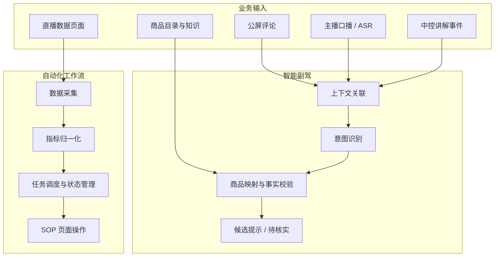

# 小满（Xiaoman）

小满是一个面向直播电商中控场景的业务自动化与 AI 辅助工具项目。项目从实际直播工作流程出发，将数据采集、商品信息管理、评论理解和后台重复操作逐步整理成可复用的模块。

项目目前主要围绕两条方向推进：

- **中控自动化**：处理定时数据采集、数据整理、页面操作和 SOP 流程。
- **直播智能副驾**：结合公屏评论、主播口播和商品信息，识别用户意图，为中控提供辅助信息。

## 项目背景

直播过程中，中控需要在直播大屏、罗盘、千川和商品管理等页面之间频繁切换，同时处理数据记录、商品讲解、评论协助等任务。这些工作有不少重复步骤，但又受到场次、商品、页面状态和业务规则的影响。

小满希望把其中适合自动化的部分沉淀为稳定流程，把大模型用于评论理解等需要语义判断的环节，并保留必要的规则校验和人工确认。

## 主要功能

### 1. 直播数据自动化

按固定时间从不同业务页面采集直播数据，并整理到结构化结果中。

- 半点数据链路：每 30 分钟采集 8 项直播指标。
- 整点数据链路：每 60 分钟采集 6 项千川指标。
- 区分数据来源、指标口径和直播场次。
- 通过 Run、Snapshot、History 等结构记录执行过程和结果。
- 对来源切换、运行锁、checkpoint、结果冻结和清理状态进行管理。

### 2. AI 评论副驾

根据直播公屏评论识别用户意图，并结合主播口播和商品上下文辅助中控理解用户问题。

当前关注的意图包括颜色、价格、材质、商品比较和有货咨询等。整体方案会关联三类上下文：

- 公屏评论：用户正在问什么。
- 主播口播 / ASR：主播最近正在介绍什么。
- 中控讲解事件与商品目录：当前场次有哪些商品，以及用户实际询问的是哪一款。

目前已完成一轮离线意图识别评估：32 条样本中，30 条返回有效结果，26 条分类匹配，按全部样本计算为 81.25%。这是小规模离线样本结果，不代表线上识别准确率。

### 3. 商品知识模块

将商品资料与不同用途的信息分开管理，当前包含：

- 产品知识：商品属性、颜色、尺寸等资料。
- 话术策略：不同问题对应的话术组织方式。
- 活动资料：活动规则和相关内容。

目前整理了 10 款商品、30 个 SKU 草稿和 107 条 FAQ，其中 106 条已有答案。知识模块处于离线基础模块阶段，不提供实时 SKU 库存或实时价格查询。

### 4. DOM / SOP 工作流

将重复的后台操作整理成可配置的步骤，通过元素映射和 SOP 流程执行页面操作。

目前支持的动作类型包括 click、input、filter / unfilter、clipboard 和 capture 等。已在本地商品管理页孪生环境中跑通商品 ID 检索、打开库存抽屉和查看信息的流程。

### 5. 语音触发与商品讲解

使用轻量 ASR 识别语音触发内容，并与商品索引关联，辅助完成商品讲解切换。流程中加入误触拦截、Dry Run、授权和日志等控制。

目前完成了核心预演和单次真实点击验证，仍需继续覆盖不同语音、商品和直播环境。

## 系统架构

下面是小满当前的逻辑架构，展示各模块之间的关系。不同模块处于不同开发和验证阶段，并不代表所有模块已经完成生产环境端到端联调。

## 技术组成

项目按模块使用相应技术，主要包括：

- JavaScript：浏览器扩展、页面交互和工作流逻辑。
- Chrome Extension / CDP：浏览器页面与网络数据观察。
- IndexedDB：本地任务状态和执行结果存储。
- Node.js：自动化测试与部分本地工具。
- ASR 与大语言模型：语音识别、评论意图理解和上下文处理。
- JSON：商品资料、指标定义、流程配置和知识模块数据结构。

## 当前开发状态

| 模块 | 当前状态 |
|---|---|
| 数据自动化 | 已完成 Phase 6 阶段验证；Phase 10 完成一次真实定时混合来源工作流验收 |
| 评论意图识别 | 已完成小规模离线评估，正在完善多源上下文关联 |
| 商品知识模块 | 已建立产品、话术策略和活动三类离线基础模块 |
| DOM / SOP | 本地孪生页面中的首条流程已跑通 |
| 语音触发讲解 | 已完成预演和单次真实点击验证 |

数据自动化 Phase 6 中，半点和整点两条链路分别完成 4/4 次阶段验证，并通过 21 项测试。Phase 10 于 2026-10-10 完成一次真实定时混合来源运行，涉及千川和罗盘两个数据源，形成 6 项冻结指标、2 个 Snapshot 和 1 条 History，Run 状态为 success，cleanup 状态为 complete。该次验收不代表长期稳定运行，也未覆盖 Worker 休眠 / 重启恢复和真实 stall reload 路径。

## 相关文档与仓库

- [项目案例](docs/project-case-study.md)
- [系统架构与关键流程](docs/architecture.md)
- [验证记录与当前边界](docs/evidence-and-validation.md)

当前仓库主要用于整理项目介绍、架构和验证文档，不包含小满完整源代码或公司业务数据。

数据自动化 POC 源码仓库：[xiaoman-data-automation-poc](https://github.com/hjs980824/xiaoman-data-automation-poc)（私有仓库，需授权访问）。
