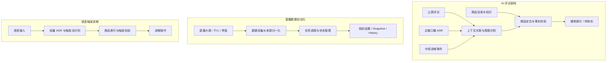

# 小满（Xiaoman）

小满是一个面向直播电商中控场景的业务自动化与 AI 辅助工具。它从实际直播流程出发，围绕数据采集、评论理解、商品知识管理和语音触发讲解，减少重复操作，并帮助中控理解直播中的用户问题。

## 核心模块

### 直播数据自动化
按固定时间从直播大屏、千川和罗盘等页面采集数据，对不同来源的指标进行归一化，并记录任务执行状态和结果。

- 半点链：每 30 分钟采集 8 项直播指标。
- 整点链：每 60 分钟采集 6 项千川指标。
- 使用 Run、Snapshot、History 等结构管理执行过程、来源快照和历史结果。

### AI 评论副驾
识别公屏评论中的用户意图，并结合主播口播、讲解事件和商品信息理解评论上下文。当前关注颜色、价格、材质、商品比较和有货咨询等问题。

副驾的处理链路是：评论与上下文关联 → 意图识别 → 商品定位 → 商品事实校验 → 生成辅助提示。缺少可信资料时应提示待核实，而不是推测实时价格或库存。

### 商品知识模块
将商品信息按用途拆分为产品知识、话术策略和活动资料，供后续检索与内容生成使用。目前整理了 10 款商品、30 个 SKU 草稿和 107 条 FAQ，其中 106 条已有答案。当前为离线基础模块，不提供实时 SKU 库存或实时价格查询。

### 语音触发讲解
使用轻量 ASR 识别语音触发内容，并与商品索引关联，辅助完成商品讲解切换。流程中考虑误触拦截、Dry Run、授权和日志记录。目前完成核心预演和单次真实点击验证，仍需继续覆盖不同语音和直播环境。

## 整体流程

小满由几条相对独立的业务链路组成。下图展示模块之间的逻辑关系，不代表所有模块已完成生产环境端到端联调。

## 阶段成果

| 模块 | 当前结果 | 验证情况 |
|---|---|---|
| 评论意图识别 | 32 条样本，30 条有效返回，26 条分类匹配（81.25%） | 小规模离线评估，不代表线上准确率 |
| 商品知识 | 10 款商品、30 个 SKU 草稿、107 条 FAQ（106 条有答案） | 离线基础模块 |
| 数据自动化 Phase 6 | 半点 8 项、整点 6 项；两条链路各完成 4/4 次阶段验证 | 21 项自动化测试通过 |
| 数据自动化 Phase 10 | 一次真实定时混合来源运行，形成 6 项冻结指标、2 个 Snapshot、1 条 History | Run success，cleanup complete；不代表长期稳定性 |
| 语音触发讲解 | 轻量 ASR、商品索引与触发校验 | 核心预演及单次真实点击验证 |

Phase 10 于 2026-10-10 完成，涉及千川和罗盘两个数据源。该次验收未覆盖 Worker 休眠 / 重启恢复和真实 stall reload 路径。各模块的开发状态和验证边界见[验证记录](docs/evidence-and-validation.md)。

## 技术组成

- JavaScript：浏览器扩展、数据处理和业务逻辑。
- Chrome Extension / CDP：浏览器页面与数据采集。
- IndexedDB：本地任务状态和执行结果存储。
- Node.js：自动化测试与本地工具。
- ASR 与大语言模型：语音识别、评论意图理解和上下文处理。
- JSON：指标定义、商品资料和知识模块数据结构。

## 文档

- [项目案例](docs/project-case-study.md)
- [系统架构与关键流程](docs/architecture.md)
- [验证记录与当前边界](docs/evidence-and-validation.md)
- [现场讲解提纲](docs/demo-script.md)

当前仓库用于整理小满的项目说明、架构和验证文档，不包含完整源代码或公司业务数据。数据自动化 POC 源码仓库：[xiaoman-data-automation-poc](https://github.com/hjs980824/xiaoman-data-automation-poc)（私有仓库，需授权访问）。
