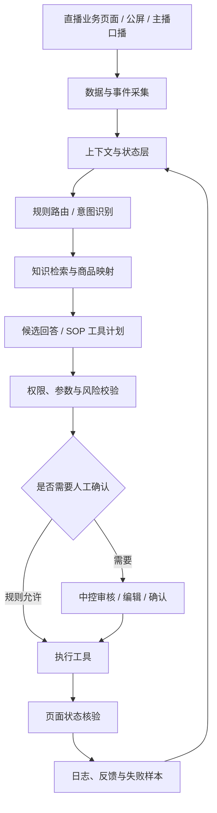

# 系统架构与关键流程

## 1. 分层视图

小满按业务职责拆分，而不是把所有能力塞进一个大模型提示词中。



该图表达系统的设计分层与目标闭环，不代表所有模块已在同一生产环境中完成端到端联调。

## 2. 数据采集层

负责从业务页面获取结构化数据，并保留数据来源和场次信息。

- 半点数据：围绕直播大屏曝光、点击、成交、转粉等指标。
- 整点数据：围绕罗盘/千川消耗、GMV、订单和成本等指标。
- 采集结果：进入表格或结构化记录，保留时间与场次上下文。
- 异常处理：缺失值、页面变化和跨场次累计值需要显式处理，不能默认补零或直接相减。

## 3. 上下文层

副驾的上下文至少区分：

| 来源 | 用途 | 注意事项 |
|---|---|---|
| 公屏评论 | 当前用户问题和意图 | 评论可能省略商品编号或上下文 |
| 主播口播/ASR | 最近讲解内容和话题 | 识别结果可能有误，需要时间窗口和可信度约束 |
| 商品目录 | 本场商品及稳定身份 | 显示顺序不能替代商品唯一标识 |
| 商品知识 | 已审核商品属性和话术资料 | 不等于实时库存、价格和活动状态 |
| 中控操作状态 | 当前讲解、弹链或工具执行状态 | 状态变化需要有来源和时间戳 |

## 4. 意图识别与知识检索

副驾优先判断“用户在问什么”，再判断“是否有可信资料回答”。

典型意图包括颜色、价格、材质、偏光/功能属性、有货咨询、多商品比较和商品定位等。对于实时库存、临时活动或未审核属性，如果系统没有可信数据源，应返回待核实状态，而不是让模型猜测。

## 5. 工具执行边界

对点击、讲解切换、商品排序、轮评、福袋等可能影响直播间的动作，建议遵循：

1. 校验当前场次与目标商品身份。
2. 校验动作参数、权限和当前状态。
3. 对高风险动作展示执行前确认。
4. 执行后读取返回结果或刷新页面。
5. 只有确认目标状态发生变化，才记录为成功。
6. 超时或结果未知时先核验，不直接重复执行。

## 6. 反馈闭环

```text
业务事件
  -> 采集与上下文
  -> 规则 / 意图识别
  -> 知识检索或工具计划
  -> 参数与权限校验
  -> 人工确认（必要时）
  -> 执行
  -> 页面状态核验
  -> 日志与失败样本
  -> 规则、知识和测试集迭代
```

## 7. 设计取舍

- 先做单一业务闭环，再扩展工具和 Agent 数量。
- 先保证商品身份和知识准确，再追求回答流畅度。
- 先保留可解释的人工确认，再逐步扩大自动执行范围。
- 先定位调用链中的主要瓶颈，再优化模型延迟和成本。
