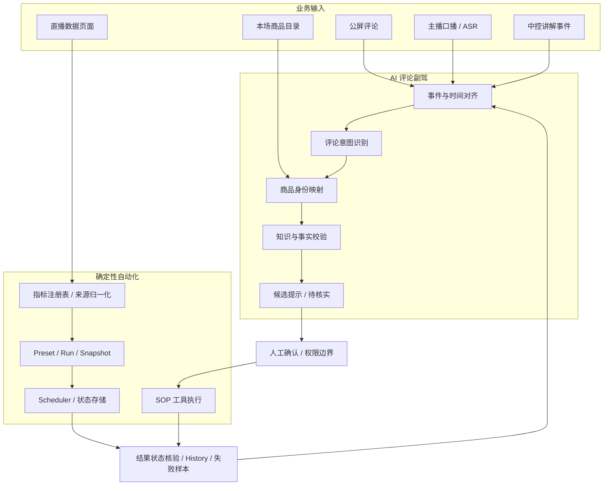

# 系统架构与关键流程

## 1. 总体架构

小满按业务职责拆分，不把所有逻辑塞进一个大模型提示词。以下是当前方案的逻辑视图；各模块验证阶段不同，不代表已在同一生产环境完成端到端联调。

## 2. AI 评论副驾：上下文先行

副驾需要区分不同来源，不应把当前讲解商品直接当成用户所问商品。

| 来源 | 用途 | 约束 |
|---|---|---|
| 公屏评论 | 识别用户问题和意图 | 评论可能省略商品编号或上下文 |
| 主播口播 / ASR | 提供最近讲解内容和时间上下文 | ASR 可能有误，需时间窗口和可信度约束 |
| 中控讲解事件 | 补充中控实际触发了哪个讲解动作 | 事件需要时间戳和商品身份 |
| 商品目录 | 定位本场完整商品及稳定身份 | 显示顺序不能替代商品唯一标识 |
| 商品知识 | 提供已审核属性、话术和活动资料 | 不等于实时库存、实时价格或当前活动状态 |

处理顺序：
1. 识别评论意图（颜色、价格、材质、功能属性、商品比较、有货咨询等）。
2. 根据评论、ASR 和讲解事件的时间关系构建上下文。
3. 在本场商品目录中定位用户真正询问的商品。
4. 检查是否存在可信商品事实来源。
5. 有依据时生成候选提示；无依据时标记待核实，不让模型猜测。

当前离线评测为 32 条样本、30 条有效返回、26 条分类匹配（26/32 = 81.25%）。这不是线上准确率。三源上下文与全量商品映射仍在迭代。

## 3. 数据自动化：来源身份与执行状态

直播数据采集不是简单地把几个数字复制进 Excel。不同页面的指标来源、刷新时机、单位和场次口径不同。

- 半点链：每 30 分钟采集 8 项直播指标。
- 整点链：每 60 分钟采集 6 项千川指标。
- 指标注册表描述指标名称、来源、单位与格式化规则。
- Normalizer 将不同来源响应转成统一结果。
- Preset 定义选择哪些指标；Run 表示一次逻辑执行；Snapshot 保存来源快照；MetricResult 保存冻结结果；History 记录最终执行。

V2 Phase 10 的一次真实定时混合工作流中，先采集千川，再采集罗盘，最终形成 6 项冻结指标、2 个 Snapshot、1 条 History；Run success，cleanup complete。该次运行耗时 9,422 ms。它是单次真实验收，不代表长期稳定性或所有异常恢复路径均已覆盖。

## 4. SOP 与工具执行边界

对点击、讲解切换、商品排序、轮评、福袋等可能影响直播间状态的动作，建议遵循：

1. 校验当前场次与目标商品身份。
2. 校验动作参数、权限和当前状态。
3. 对高风险动作执行前确认。
4. 执行后读取返回结果或刷新页面。
5. 只有确认目标状态发生变化，才记录为成功。
6. 超时或结果未知时先核验，不直接重复执行。

本地 SOP 引擎以元素映射和流程配置表达 click、input、filter/unfilter、clipboard、capture 等步骤；已跑通本地孪生页面中的商品 ID 检索至库存抽屉查看流程。该验证不代表正式商家后台全部动作已验收。

## 5. 状态与可靠性设计

数据自动化 V2 已引入：
- 运行锁与来源 owner，避免同一执行过程被并发任务抢占。
- 来源 checkpoint，保留已完成来源结果。
- 冻结 MetricResult，避免后续编辑覆盖历史执行结果。
- 明确 Run 终态和 cleanup。
- 异常、超时、来源身份不匹配和恢复场景测试。

技术人员可核验的入口见[证据与验证边界](evidence-and-validation.md)中的文件清单。

## 6. 设计取舍

- 先保证商品身份和知识准确，再追求回答流畅度。
- 先做单一业务闭环，再扩展 Agent 数量和工具范围。
- 模型负责理解与辅助决策，确定性动作交给规则和工具。
- 先保留可解释的人工确认，再逐步扩大自动执行范围。
- 先定位调用链主要瓶颈，再优化模型延迟和成本。
