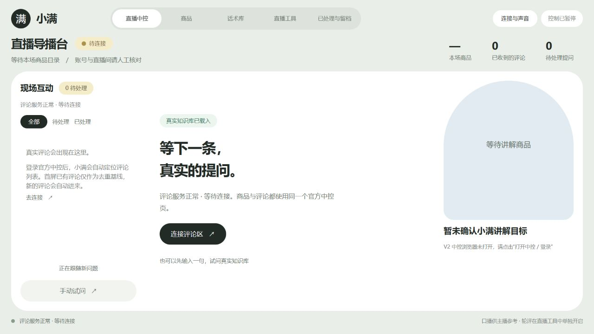
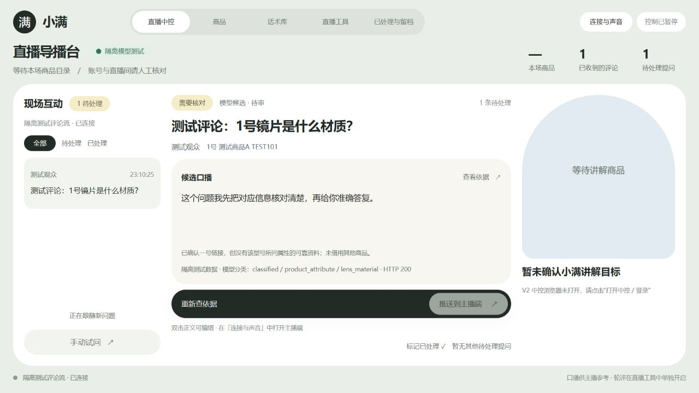
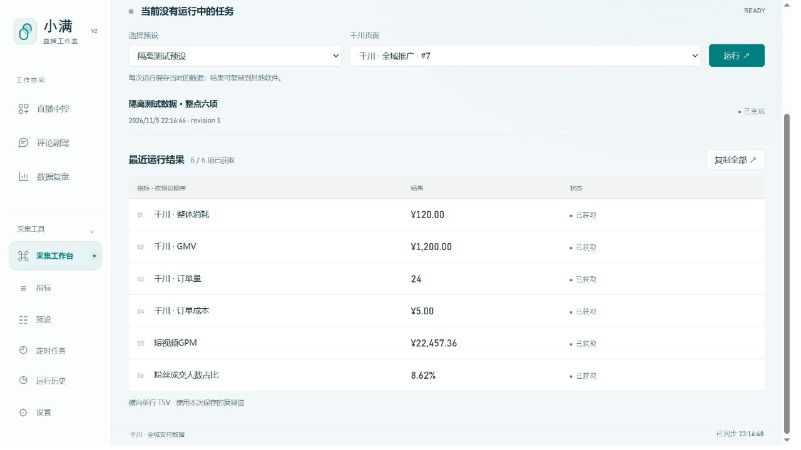
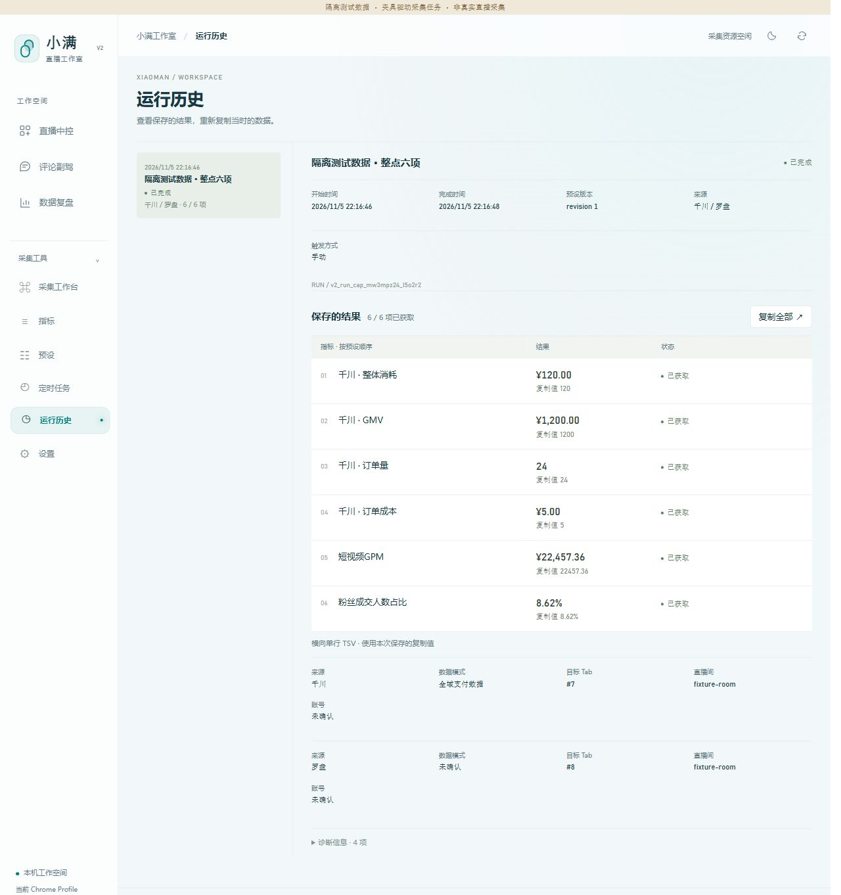

# 运行截图说明

这些截图来自本机运行的小满界面，使用隔离测试环境。它们展示功能与对应测试状态，不代表生产环境端到端验收。

## 主界面

展示导播台布局及评论服务等待连接的状态。界面和本机服务实际运行，知识库使用合成测试资料，**没有连接正式直播间**；界面中的“真实知识库已载入”表示本机知识库服务已载入，并不表示资料来自真实直播。

## AI 评论副驾

展示合成评论、测试商品上下文、模型意图分类及待核对状态。测试评论在隔离评论流中经实际模型调用处理；观众、评论和商品上下文均为合成数据。模型返回 HTTP 200 仅表示请求获得成功响应，**不代表商品事实已核实**；所问属性缺少可靠依据，因此保留待核对。

## 数据自动化

展示采集工作台中已完成的测试 Run 及六项指标。测试运行使用罗盘和千川的隔离测试夹具，由现有采集执行器处理；数值为测试数据，**不是真实直播采集**。

## 数据来源补充

运行历史展示同一测试 Run 的六项结果、完成时间以及千川和罗盘两个来源的上下文。对应测试运行记录包含两个来源 Snapshot；此图展示的是隔离测试结果，`fixture-room` 为测试标识，不是真实直播间。
